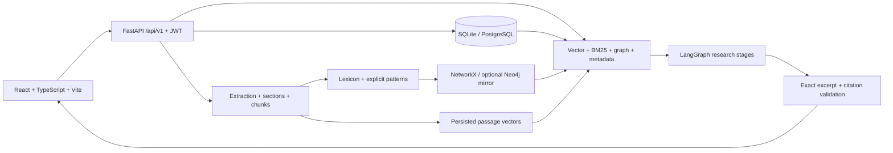

# PharmaGraph AI

**A knowledge graph augmented retrieval system for evidence-grounded pharmaceutical literature research.**

PharmaGraph AI turns user-supplied documents into traceable passages, normalized terms, explicit reported relationships, and searchable evidence. It provides a React research workspace and a persistent FastAPI backend. It runs without a paid API key, Neo4j server, or downloaded language model.

## Abstract and introduction

Pharmaceutical evidence is distributed across papers, technical reports, trial records, and databases. Keyword-only search loses relationships; unconstrained language generation can invent claims and citations. This project combines document retrieval with a provenance-preserving graph, then produces validated source excerpts. It is intended for researchers, students, and literature analysts. It has no clinical validation and does not provide patient treatment decisions.

## Objectives and proposed system

- Maintain a private, searchable literature repository with ingestion failures and duplicates visible.
- Preserve page, section, document, and passage references from extraction through answers.
- Identify pharmaceutical entities and explicit reported relationships without inferring edges from co-occurrence.
- Combine vectors, BM25, bounded graph expansion, and metadata filters.
- Surface explicit contradictions and compare source evidence without asserting comparative efficacy.
- Keep the backend authoritative and isolate every user's documents, graph, sessions, logs, and bookmarks.

## Quick start (Python 3.12, Node 22.12+ or 24, pnpm)

Run commands from the repository root. Do not use the Windows system Python 3.15 for these dependency pins.

```powershell
python -m venv .venv
.\.venv\Scripts\python.exe -m pip install -r backend/requirements.txt
Copy-Item .env.example .env
.\.venv\Scripts\python.exe -m uvicorn app.main:app --app-dir backend --reload --port 8000
```

In a second terminal:

```powershell
cd frontend
pnpm install --frozen-lockfile
pnpm dev
```

Open [the local application](http://localhost:5173), register an account with a password of at least 10 characters, then choose **Load educational corpus** on the dashboard or upload your own permitted documents. There is no hidden account or shared demo password. Sample suggestions use fictional Drug Aster, Drug Boreal, and Target Sigma.

If the development optimizer stalls on your machine, use `pnpm build` followed by `pnpm preview --port 5173` in `frontend`. For alternate backend ports set `VITE_BACKEND_PROXY=http://127.0.0.1:8007` in the frontend process environment. The Windows helper `scripts/start-local.ps1` accepts `-BackendPort` and `-FrontendPort`.

On macOS/Linux, use `.venv/bin/python` instead. If pnpm is absent, enable Corepack with `corepack enable` or install pnpm through your supported Node installation.

## Architecture and technology stack



Frontend: React Router, Axios, Tailwind CSS plus custom responsive styles, Recharts, Lucide, React Flow. Backend: FastAPI/Pydantic, SQLAlchemy/Alembic, PyJWT, PyMuPDF, python-docx, BeautifulSoup, NumPy/scikit-learn, NetworkX, LangGraph, HTTPX; optional Neo4j and Sentence Transformers. Exact frontend versions and resolved dependencies are recorded in `frontend/package.json` and `frontend/pnpm-lock.yaml`.

## Features and routes

| Area | Working behavior |
| --- | --- |
| Authentication | Registration, login, expiring JWT, hashed passwords, per-owner authorization |
| Documents | Multi-file upload, PDF/TXT/DOCX/CSV/JSON/HTML extraction, metadata, page/section chunks, file/DOI/PMID duplicates, reprocess/delete, JSON metadata export |
| NLP | Curated terms and aliases, explicit annotations, original/normalized names, passage mentions, audited corrections |
| Knowledge graph | Source-linked explicit edges, negation, neighborhood expansion, relationship/source filters, bounded paths, evidence panel, JSON export |
| Search | Vector, BM25, hybrid, graph; year/type/source/entity filters in API; ranking components in UI |
| Research | LangGraph workflow, deterministic grounded extracts, optional API quote selection, exact citation validation, insufficient-evidence responses |
| Workspace | Persisted sessions and questions, bookmarks, JSON exports, comparison and explicit contradiction inspection |
| Analytics | Owner-scoped counts and distributions computed from persisted records |
| Discovery | Read-only official PubMed, Europe PMC, PubChem, ClinicalTrials.gov, UniProt API adapters |

The 20 requested views are represented by the public landing and authentication pages and `/app/dashboard`, `/app/assistant`, `/app/documents`, `/app/upload`, `/app/documents/:id`, `/app/entities`, `/app/drugs`, `/app/diseases`, `/app/targets`, `/app/graph`, `/app/search`, `/app/evidence`, `/app/compare`, `/app/conflicts`, `/app/workspace`, `/app/logs`, `/app/settings`. Entity category tabs also expose drugs/diseases/targets.

## Document processing and metadata

Uploads use random server-side IDs as storage paths. Size and extension checks precede extraction; PDF signatures and DOCX expansion sizes are checked. Extraction failures are persisted as failed jobs. Scanned PDFs require external OCR. DOCX/plain-text formats do not invent page numbers. Scientific section headings are preserved; chunks contain up to 260 words with a 40-word overlap. Metadata comes from explicit labeled fields and DOI/PMID patterns. Missing bibliographic data remains null. PDFs may need metadata correction upstream if fields are not explicitly labeled. Reprocessing regenerates passages and graph evidence transactionally.

Use explicit metadata fields such as `Title:`, `Authors:` (semicolon separated), `Year:`, `Study type:`, `Journal:`, `Abstract:`, `DOI:`, `PMID:`, `Source URL:`, `Keywords:`, and `License:`. Metadata identifiers are extracted, not independently verified against a publisher.

## Entity extraction and graph design

Default extraction is conservative and limited to a small curated lexicon, aliases, and annotations such as `Drug: Example compound.` or `Target: Example receptor.` It is not comprehensive biomedical NER. Corrections are available in the entity inspector; subsequent reprocessing uses saved terms and aliases. No external biomedical identifiers are invented.

Relationships require an explicit supported subject–verb–object pattern with compatible entity types. Negation is retained separately. Every edge references a passage, document, evidence excerpt, method, study type, year, and synthetic-data label. An edge means **reported finding**, not accepted clinical knowledge. See [graph design](docs/knowledge_graph_design.md).

## Embeddings, vector retrieval, and hybrid ranking

The default `EMBEDDING_MODEL=local-hashing-v1` creates normalized 512-dimensional unigram/bigram lexical hashing vectors. They persist with passages in SQL and are searched using actual cosine dot products. This is an offline lexical fallback, **not a pretrained semantic model**. BM25 is computed on the filtered passage corpus. Default hybrid weights are vector .40, keyword .25, graph .25, title overlap .10; weights are validated and normalized. Scores measure relevance, never pharmaceutical reliability or clinical certainty.

To enable pretrained semantic embeddings:

```powershell
.\.venv\Scripts\python.exe -m pip install -r backend/requirements-models.txt
# Set EMBEDDING_MODEL to a SentenceTransformer model name or local model directory.
# For a first explicit download set MODEL_DOWNLOADS=true. Thereafter set it to false.
.\.venv\Scripts\python.exe scripts/manage.py reprocess --email you@example.com
```

Changing the embedding model requires reprocessing. Network-free operation with a pretrained model requires its files to have been downloaded previously. Evaluate biomedical retrieval on your own corpus before choosing a model. The default SQL vector scan is appropriate for a small local corpus; it is not an approximate-nearest-neighbor service. Optional model dependencies are separate because of their size and platform compatibility.

For an optional persistent FAISS index, install `backend/requirements-faiss.txt`, set `VECTOR_STORE=faiss` and `VECTOR_STORE_PATH=runtime/vectors`, and restart the backend. The adapter creates a real `IndexFlatIP` index and passage-ID mapping per owner and corpus/filter fingerprint. SQL vectors remain authoritative; changed passage sets use new fingerprints. Keep this directory on persistent protected storage. Old cache files are not served or reused for a different passage set; administrators can remove obsolete cache files during storage maintenance. FAISS indexing is separate from the choice of lexical or pretrained embeddings.

## RAG, grounding, and citation validation

An actual LangGraph StateGraph executes query understanding, entity identification, document retrieval, graph reasoning, evidence evaluation, generation, citation validation, and insight packaging. The orchestrator and all eight stages write execution logs. These are bounded deterministic workflow nodes, not independent autonomous LLMs.

Offline responses show verbatim passages, each with source IDs and page/section references. An OpenAI-compatible provider can select exact quotes when `LLM_PROVIDER=openai-compatible` and `LLM_API_KEY` are configured. Selection JSON is Pydantic-validated; text must be a substring of a retrieved passage. Provider errors fall back visibly to deterministic extraction. The system intentionally does not publish unchecked free-form scientific paraphrases. Citation validation checks source-set membership, document IDs, passage IDs, exact quotes, pages, stored DOI/PMID and finding coverage. It does not establish the truth of source text.

Synthetic findings have persistent warnings. No confidence probabilities are generated. Explicit positive/negative graph statements trigger potential-conflict flags; this detector cannot establish statistical disagreement, equivalence of models, or general consensus.

## Database and APIs

SQLAlchemy models define users, documents with JSON metadata/references, passages with vectors, entities with synonym/identifier JSON, mentions, relationships with source evidence, ingestion jobs, research sessions/messages, bookmarks, execution logs, and audit logs. Metadata and evidence are embedded or linked records instead of empty placeholder tables. Cascading foreign keys remove document-bound passages, mentions, edges, and bookmarks. See [schema details](docs/database_schema.md).

The API is under `/api/v1`. Interactive OpenAPI documentation is served at [Swagger UI](http://localhost:8000/docs). All corpus and workspace endpoints require `Authorization: Bearer <token>`. Request validation and bounded query controls are in the generated schema. See [API documentation](docs/api_documentation.md).

Local startup creates missing tables. For managed migration setup:

```powershell
cd backend
..\.venv\Scripts\python.exe -m alembic upgrade head
```

The initial migration creates the model metadata. Future schema changes require reviewed Alembic migrations; `create_all` cannot upgrade existing columns.

## CLI utilities

```powershell
.\.venv\Scripts\python.exe scripts/init_db.py
.\.venv\Scripts\python.exe scripts/manage.py create-user --email you@example.com --name Researcher
.\.venv\Scripts\python.exe scripts/seed_demo_data.py --email you@example.com
.\.venv\Scripts\python.exe scripts/ingest_documents.py --email you@example.com --files paper.pdf notes.txt
.\.venv\Scripts\python.exe scripts/generate_embeddings.py --email you@example.com
.\.venv\Scripts\python.exe scripts/extract_entities.py --email you@example.com
.\.venv\Scripts\python.exe scripts/build_graph.py --email you@example.com
```

Embedding/entity regeneration both run the complete provenance-preserving reprocessing pipeline. The seed operation is idempotent by file hash and requires an existing owner.

## Configuration and security

Copy `.env.example`; keep secrets out of Git. Production requires a unique `JWT_SECRET`. Local mode persists a generated secret in `runtime/.jwt-secret`. Passwords use salted PBKDF2-HMAC-SHA256 with 600,000 iterations. Tokens expire after eight hours. All private lookups enforce owner IDs; write endpoints require researcher/admin roles. Registration only grants researcher. Documents are untrusted input and never executable instructions. Neo4j uses parameterized fixed queries; no generated Cypher executes. API keys stay on the server. Browser tokens are session-scoped; deploy under HTTPS and maintain XSS protections.

Rate limiting is per-process and per-client address. For multiple workers or hostile public traffic, use a trusted reverse proxy with request limits and a shared rate-limit service. Ingestion is synchronous and bounded for small local uploads; move large workloads to a job queue. Set ingress request/time limits and do not expose unbounded direct application traffic.

For exact resolved backend dependencies on Python 3.12, install `backend/requirements.lock`. The direct requirements file remains the source for intentional upgrades; regenerate the lock with `python scripts/lock_dependencies.py` after testing changes.

## Testing

```powershell
.\.venv\Scripts\python.exe -m pytest backend/tests -q
cd frontend
pnpm test
pnpm build
pnpm audit --prod
```

Tests use temporary SQLite storage, deterministic synthetic documents, real PDF/DOCX extraction, and mocked frontend API responses. They cover access isolation, page preservation, metadata, duplicates/failures, provenance, normalization, all retrieval modes, graph paths, citations, conflict detection, comparisons, bookmarks, and history. External APIs, paid LLMs, PostgreSQL, and Neo4j require separate integration credentials/services. See [verification record](docs/verification.md) for the actual executed results and remaining validation limits.

## Deployment

```powershell
docker compose up --build
```

Open [the Docker frontend](http://localhost:8080). The backend has a named persistent volume for SQLite, document bytes, and its local secret. Docker is configured but must be tested on a Docker-capable host. Optional PostgreSQL/Neo4j Compose profiles need explicit passwords and backend URL configuration; they are not required for default local mode.

For free Render demos, `render.yaml` now selects a Free web service and a Free PostgreSQL database in the same region. `DOCUMENT_STORAGE=database` keeps original upload bytes in SQL so they survive web-service restarts; vectors, accounts and research sessions are also in SQL. **Render's free PostgreSQL expires 30 days after creation**, and the free web service sleeps when idle. This configuration is for temporary demos, not permanent production storage. No paid resource is selected. Bring a durable external PostgreSQL connection for longer-lived free hosting, or explicitly approve a paid plan separately. Run migrations during a controlled deployment. Configure optional Neo4j credentials and use **Sync graph** to mirror current owner's SQL graph with fixed queries. SQL remains authoritative.

For Vercel set the project root to `frontend`, build with `pnpm build`, output `dist`, and set `VITE_API_URL=https://YOUR_BACKEND/api/v1` at build time. Configure the exact frontend origin on the backend. The SPA rewrite is in `frontend/vercel.json`. Never put LLM or database credentials in a `VITE_` variable. No hosted deployment is claimed by this repository.

## Limitations and future enhancements

This is a functional local research application, not a clinically validated platform. Extraction recall is intentionally limited; relations cover explicit patterns only. Document metadata extraction is heuristic. Lexical fallback retrieval has no pretrained semantics. Vector scanning and synchronous ingestion target small corpora. Provider mode is extractive rather than abstractive. Conflict detection is a narrow rule, not scientific adjudication. External discovery does not automatically ingest or license source content. MeSH/ChEBI/UMLS/DrugBank linking, comprehensive SciSpaCy NER, a scalable vector service, OCR, async workers, calibrated evidence evaluation, shared production rate limiting, account recovery, and full production observability remain extensions. There are no benchmark claims of clinical/retrieval accuracy.

Research evaluation should measure extraction precision/recall, retrieval recall@k/MRR/nDCG, citation coverage, exact-quote validity, and human-reviewed evidence sufficiency. See [research methodology](docs/research_methodology.md) and [phase record](docs/phases.md).

Original GitHub repository README preserved in [docs/original-repository-readme.md](docs/original-repository-readme.md).
